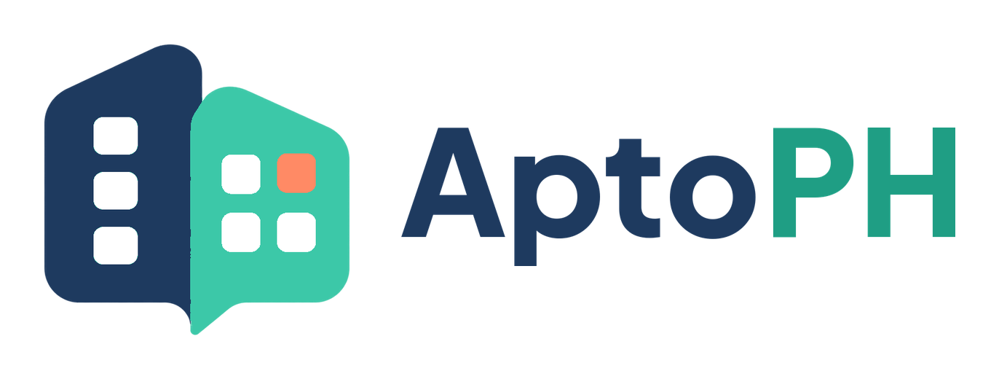

# AptoPH — Gráfica 2026 · "Comunidad cercana"

Nueva identidad visual de AptoPH: profesional, cálida y fácil de entender para residentes,
administradores y consejos. Reemplaza la línea navy + teal de [`docs/brand/`](../docs/brand/),
que se conserva solo como referencia histórica.



## Concepto

**Dos torres que conversan.** El símbolo son dos edificios juntos. El de la derecha termina en la
punta de una **burbuja de chat**, y una de sus ventanas está encendida en **coral**.

- **Torre azul**: la administración, que da estructura y confianza.
- **Torre menta**: la comunidad de residentes.
- **Burbuja de chat**: la comunicación directa entre las dos, que es la razón de ser de la app.
- **Ventana coral**: el hogar de cada residente. Es el único acento cálido del símbolo.

El estilo de las ilustraciones es plano, con formas redondeadas, sombras suaves, sin contornos y
con personas diversas y amables. Se generó con **Layer AI (GPT Image 2.6 Flare)**: el hero
`aptoph-hero-comunidad` sirvió de referencia de estilo para todas las demás piezas, y el
símbolo sirvió de referencia para el set de íconos. Así todo comparte el mismo lenguaje.

## Contenido

| Carpeta | Piezas | Uso |
| --- | --- | --- |
| [`logo/`](logo/) | **SVG**: horizontal (color, `-white`, `-mono`), apilado (color, `-white`), símbolo (color, `-white`, `-mono`). **PNG**: las mismas versiones, el símbolo a 1024 y 256 px y el wordmark | Usa el SVG en web (navbar, login, landing). El PNG es para correos y documentos |
| [`app-icon/`](app-icon/) | Ícono 1024/512/192/180, redondeado, oscuro, adaptativo Android (foreground + background), `favicon.ico`, `favicon-32.png` | Tiendas, PWA, Flutter, `public/` de las webs |
| [`splash/`](splash/) | `aptoph-splash.png` (con logo y lema), 2 fondos sin logo, `aptoph-splash-native-icon.png` | App móvil (pantalla de carga) |
| [`hero/`](hero/) | `comunidad` (principal), `comunidad-limpio` (la misma escena sin las tarjetas flotantes, para poner encima notificaciones reales en HTML), `comunidad-alt`, `administracion`, `app-movil`, en PNG, WebP y WebP de 960 px | Landing: hero, sección backoffice, sección app |
| [`landing/`](landing/) | `antes-despues` (díptico: la misma administradora con papeles y luego con AptoPH) y `cta-noche` (el conjunto de noche, para la franja final) | Secciones del landing |
| [`headers/`](headers/) | `pagos`, `reservas`, `comunicados`, `porteria` (3:1), en PNG y WebP | Cabeceras de módulo en web/backoffice y en la landing |
| [`icons/`](icons/) | 18 íconos de funciones con fondo transparente, a 512 y 128 px; las hojas originales están en `source/` | Menú, tarjetas de funciones, landing |
| [`illustrations/`](illustrations/) | `empty-pagos-al-dia`, `empty-sin-mensajes`, `empty-sin-resultados`, `empty-bienvenida` (transparentes) | Estados vacíos, confirmaciones, onboarding |
| [`social/`](social/) | Imagen OG 1200×630, portada 1500×500 (X/Facebook), portada LinkedIn 1584×396, avatar 1080 | Metadatos y redes |
| [`concepts/`](concepts/) | Las 4 exploraciones del símbolo (la elegida es la `logo-symbol-4`) | Solo referencia: **no usar como logo** |
| [`scripts/`](scripts/) | Scripts que arman los logos, íconos y piezas a partir de lo que entrega Layer | Regenerar |

En los heroes y headers, el tercio izquierdo (o la mitad, en los headers) es espacio crema libre
para poner el título en HTML. No pongas texto dentro de la imagen. Así se traduce, se indexa y
se adapta al móvil.

### Íconos

`pagos` · `estado-de-cuenta` · `reservas` · `zonas-comunes` · `comunicados` · `pqrs` ·
`visitantes` · `paquetes` · `parqueadero` · `asambleas` · `mantenimiento` · `documentos` ·
`residentes` · `unidades` · `seguridad` · `notificaciones` · `mascotas` · `reportes`

Son ilustrativos y van a 32 px o más. Para la interfaz de 16 a 24 px, sigue usando una librería
de íconos de línea (p. ej. Lucide) en color `brand-700`.

## Color

| Rol | Nombre | HEX | Uso |
| --- | --- | --- | --- |
| Primario | Azul profundo | `#1E3A5F` | Marca, texto principal, botones primarios, navbar |
| Acento | Menta | `#3CC8A8` | Símbolo, ilustraciones, fondos de chips, gráficos |
| Acento para texto | Menta 700 | `#187A66` | Enlaces y texto menta sobre fondo claro |
| Calidez | Coral | `#FF8A65` | Detalles puntuales, notificaciones, la ventana del logo |
| Fondo | Crema | `#FAF7F2` | Fondo de página (en lugar del blanco puro) |
| Superficie | Blanco | `#FFFFFF` | Tarjetas sobre crema |
| Texto secundario | Pizarra | `#4A607A` | Descripciones, metadatos |

Escalas completas, tipografías, radios y sombras en [`tokens.css`](tokens.css) (formato `@theme`
de Tailwind 4).

**Contraste (WCAG 2.1):**

| Combinación | Contraste | Veredicto |
| --- | --- | --- |
| Azul `#1E3A5F` sobre crema | 10.8:1 | ✅ Cualquier texto |
| Blanco sobre azul `#1E3A5F` | 11.5:1 | ✅ Botón primario |
| Menta 700 `#187A66` sobre crema | 4.9:1 | ✅ Texto normal |
| Pizarra `#4A607A` sobre crema | 6.1:1 | ✅ Texto secundario |
| Tinta `#102038` sobre menta `#3CC8A8` | 7.8:1 | ✅ Botón secundario o chip |
| Blanco sobre menta `#27AD8F` | 2.8:1 | ⚠️ No: los botones menta llevan texto oscuro |
| Menta `#3CC8A8` o coral `#FF8A65` sobre blanco | 2.1–2.3:1 | ⚠️ Solo formas e íconos, **nunca texto** |

Proporción sugerida: 60% crema y blanco, 25% azul, 10% menta y 5% coral.

## Tipografía

| Rol | Familia | Pesos | Uso |
| --- | --- | --- | --- |
| Display | **Plus Jakarta Sans** | 600, 700, 800 | Logotipo (800), títulos, cifras grandes |
| Texto / UI | **Inter** | 400, 500, 600 | Interfaz, tablas, formularios |

Ambas están en Google Fonts con licencia SIL OFL. En el logotipo, "Apto" va en azul `#1E3A5F` y
"PH" en menta `#1F9E84`. En la versión negativa, "Apto" va en blanco y "PH" en menta `#3CC8A8`.

## Reglas de uso del logo

- **Área de protección**: deja libre alrededor del logo la mitad de la altura del símbolo.
- **Tamaño mínimo**: el horizontal a 120 px de ancho; el símbolo a 24 px. Por debajo, usa el favicon.
- **Fondos**: sobre crema o blanco usa la versión a color. Sobre azul o fondos oscuros usa
  `-white`. Para una sola tinta usa `-mono`.
- **No hacer**: recolorear las torres, quitar la ventana coral o la punta de la burbuja,
  cambiar la tipografía, deformar o rotar el logo, ni añadirle sombras o contornos.
- **Nombre**: siempre **AptoPH**, sin espacio, con A, P y H en mayúscula.

## Integración rápida

```html
<!-- index.html de web / backoffice / landing -->
<link rel="icon" href="/favicon.ico" sizes="any" />
<link rel="apple-touch-icon" href="/apple-touch-icon.png" />  <!-- app-icon/aptoph-app-icon-180.png -->
<meta property="og:image" content="https://…/og-image.png" /> <!-- social/aptoph-og-image.png -->
<meta name="theme-color" content="#FAF7F2" />
```

```yaml
# Flutter · pubspec.yaml (flutter_launcher_icons + flutter_native_splash)
flutter_launcher_icons:
  image_path: branding/app-icon/aptoph-app-icon-1024.png
  adaptive_icon_foreground: branding/app-icon/aptoph-adaptive-foreground.png
  adaptive_icon_background: "#FAF7F2"
flutter_native_splash:
  color: "#FAF7F2"
  image: branding/splash/aptoph-splash-native-icon.png
```

## Regenerar

Las imágenes base salen de Layer. Los scripts recortan el fondo, ajustan el símbolo a los colores
exactos de la paleta, componen el logotipo con la fuente real y arman las piezas derivadas.

```bash
python3 -m venv .venv && .venv/bin/pip install numpy scipy pillow
curl -L -o PlusJakartaSans.ttf "https://github.com/google/fonts/raw/main/ofl/plusjakartasans/PlusJakartaSans%5Bwght%5D.ttf"
.venv/bin/pip install fonttools
.venv/bin/python branding/scripts/build_svg.py branding/scripts/symbol-source.svg PlusJakartaSans.ttf branding/logo
.venv/bin/python branding/scripts/build_logo.py branding PlusJakartaSans.ttf
.venv/bin/python branding/scripts/build_assets.py branding PlusJakartaSans.ttf social,webp
```

`build_assets.py` sin el último argumento ejecuta todos los pasos: `icons`, `spots`, `splash`,
`social` y `webp`. Los pasos `icons` y `spots` esperan las hojas originales
(`sheet-*.png`) en la raíz de su carpeta, así que primero hay que copiarlas desde `source/`.
