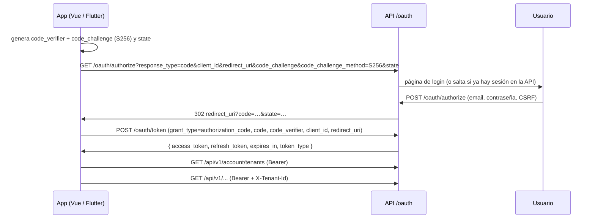

# Autenticación — OAuth 2.1 (Authorization Code + PKCE)

La API (`apps/api`) actúa como **servidor de autorización OAuth** propio. Todas las apps
(web de residentes, backoffice y app móvil) inician sesión con el flujo
**Authorization Code + PKCE (S256)**. No hay endpoints de login con usuario/contraseña en JSON.

## Conceptos

| Concepto | Descripción |
| --- | --- |
| **Cliente OAuth** (`oauth_clients`) | Una **aplicación**: `web-residents`, `web-admin`, `mobile`. Es global, **no** pertenece a un tenant |
| **Usuario** (`users`) | Persona con una sola cuenta para toda la plataforma |
| **Tenant** | Se elige **después** del login entre los conjuntos donde el usuario tiene `enrollments` activos |
| **Access token** | Opaco (`oat_…`), dura 1 hora. Se envía como `Authorization: Bearer …` |
| **Refresh token** | Opaco, dura 30 días y **rota en cada uso**. Si se reutiliza uno ya rotado, se revoca toda la familia |

Clientes sembrados para desarrollo (`node ace db:seed`):

| client_id | redirect_uri | post_logout_redirect_uri |
| --- | --- | --- |
| `web-residents` | `http://localhost:5173/auth/callback` | `http://localhost:5173/` |
| `web-admin` | `http://localhost:5174/auth/callback` | `http://localhost:5174/` |
| `mobile` | `co.apartadock.mobile:/oauth/callback` | `co.apartadock.mobile:/logout` |

Usuarios de desarrollo (contraseña `password123`): `admin@apartadock.test` (administrator) y
`residente@apartadock.test` (resident + council_member), ambos en el tenant `reservas-del-bosque`.

## Flujo



## Endpoints

### `GET /oauth/authorize`

| Parámetro | Obligatorio | Notas |
| --- | --- | --- |
| `response_type` | sí | Siempre `code` |
| `client_id` | sí | |
| `redirect_uri` | sí | Debe coincidir **exactamente** con uno registrado |
| `code_challenge` | sí | `base64url(sha256(code_verifier))` |
| `code_challenge_method` | sí | Sólo `S256` |
| `state` | recomendado | Se devuelve tal cual; la app debe verificarlo |
| `scope` | no | Se guarda, aún no se aplica |
| `prompt=login` | no | Fuerza el formulario aunque exista sesión |

- `client_id` o `redirect_uri` inválidos → página de error, **nunca** se redirige.
- Otros errores → redirección a `redirect_uri?error=…&error_description=…&state=…`.
- La API mantiene una sesión propia por cookie (SSO): si el usuario ya inició sesión, se
  redirige directamente con el código.

### `POST /oauth/token`

`Content-Type: application/x-www-form-urlencoded` (también acepta JSON).

```
grant_type=authorization_code&client_id=web-residents&code=…&redirect_uri=…&code_verifier=…
grant_type=refresh_token&client_id=web-residents&refresh_token=…
```

Respuesta `200`:

```json
{ "access_token": "oat_…", "token_type": "Bearer", "expires_in": 3600, "refresh_token": "…" }
```

Errores con formato RFC 6749: `{ "error": "invalid_grant", "error_description": "…" }`
(`invalid_request`, `invalid_client`, `invalid_grant`, `unsupported_grant_type`).

Los códigos de autorización duran 60 s y son de **un solo uso**.

### `POST /oauth/revoke`

`client_id` + `token` (refresh token). Revoca la familia completa y borra sus access tokens.
Siempre responde `200` (RFC 7009).

### `GET /oauth/logout`

`client_id`, `post_logout_redirect_uri`, `state`. Cierra la sesión SSO de la API y redirige
si la URI está registrada para el cliente.

**Cerrar sesión en una app** = `POST /oauth/revoke` (refresh token) + `GET /oauth/logout`.

### Clientes confidenciales

Si un cliente es `type = confidential` debe enviar `client_secret` en el body o con HTTP Basic
(`Authorization: Basic base64(client_id:client_secret)`). PKCE sigue siendo obligatorio.

## API y tenant activo

| Endpoint | Requiere | Descripción |
| --- | --- | --- |
| `GET /api/v1/account/profile` | Bearer | Usuario autenticado |
| `GET /api/v1/account/tenants` | Bearer | Conjuntos con enrollment activo y roles en cada uno |
| `POST /api/v1/account/logout` | Bearer | Borra el access token actual |
| `GET /api/v1/tenant` | Bearer + `X-Tenant-Id` | Contexto del tenant activo y roles |

Las rutas de un tenant usan `middleware.tenant()`. Ese middleware:

1. Lee `X-Tenant-Id` (UUID). Si falta o no es válido, responde `400`.
2. Exige un enrollment `active` del usuario en ese tenant, vigente por `starts_on` / `ends_on`,
   y que el tenant esté en `trial` o `active`. Si no se cumple, responde `403`.
3. Deja `ctx.tenant` y `ctx.tenantRoles` disponibles para controladores y policies.

Para restringir por rol: `middleware.tenant({ roles: ['administrator', 'council_member'] })`.

## Implementación

| Archivo | Rol |
| --- | --- |
| `app/services/oauth_service.ts` | Códigos, PKCE, emisión, rotación y revocación de tokens |
| `app/services/oauth_authorize_request.ts` | Validación de la petición de autorización |
| `app/controllers/oauth/*` | Endpoints `/oauth/*` |
| `resources/views/oauth/*.edge` | Página de login, error y cierre de sesión |
| `app/middleware/tenant_middleware.ts` | Resolución del tenant activo |
| `config/oauth.ts` | Duración de tokens y códigos |
| `tests/functional/oauth/*` | Tests del flujo completo |

Seguridad:

- Códigos y refresh tokens se guardan sólo como hash SHA-256.
- Consumo atómico de códigos y rotación atómica de refresh tokens (protección frente a carreras).
- CSRF activo sólo en el formulario de login (`/oauth/authorize`).
- `Cache-Control: no-store` en las respuestas de token.

## Pendiente

- Limitar intentos de login (`@adonisjs/limiter`).
- Recuperación de contraseña y aceptación de invitaciones (`enrollments.invitation_token_hash`).
- Comando `ace` para crear y administrar clientes OAuth en producción.
- Scopes reales y pantalla de consentimiento si en el futuro hay clientes de terceros.
- Cliente PKCE en `web-residents`, `web-admin` y `mobile`.
