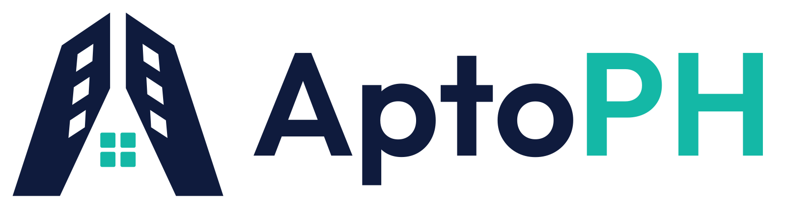

# AptoPH — Identidad de marca

**AptoPH** — plataforma para administrar conjuntos de propiedad horizontal.



## Concepto

El símbolo es una **"A" formada por dos torres residenciales** que se inclinan y se apoyan en la
cima. Entre ellas, a la altura de la calle, hay una **ventana encendida en teal**: el hogar que
la plataforma cuida.

- **Dos torres que se sostienen**: comunidad, copropiedad y gobierno compartido.
- **La "A"**: inicial de *Apto* y forma de techo, que da protección.
- **La ventana teal**: el residente en el centro. Es el único acento de color del símbolo.

En el logotipo, **"Apto"** va en navy (estructura, confianza) y **"PH"** (propiedad horizontal)
en teal. Así se lee la categoría del producto de un vistazo.

La exploración se hizo con Layer AI (GPT Image 2.5): 3 direcciones y luego un refinamiento de la
elegida. Después el símbolo se redibujó a mano como vector geométrico simétrico, y el logotipo
usa una tipografía real convertida a trazos. Las imágenes de exploración están en
[`concepts/`](concepts/) solo como referencia; **no se deben usar como logo**.

| Archivo | Dirección |
| --- | --- |
| `concepts/a-towers-*` | ✅ Elegida: torres que forman la A |
| `concepts/b-stack-*` | Pisos apilados con un check (descartada por genérica) |
| `concepts/c-icon-*` | Casa con cerradura (descartada por ser un cliché del sector) |
| `concepts/r-*` | Refinamientos de la dirección A (símbolo, logo horizontal, ícono) |

## Archivos

Usa siempre los **SVG** de [`logo/`](logo/). Los PNG de [`png/`](png/) son para correos,
documentos y tiendas de apps.

| Pieza | SVG | Uso |
| --- | --- | --- |
| Logo horizontal | `logo/aptoph-logo-horizontal.svg` | Principal: navbar, login, documentos |
| Logo horizontal (negativo) | `logo/aptoph-logo-horizontal-white.svg` | Sobre navy, fotos oscuras o modo oscuro |
| Logo horizontal (una tinta) | `logo/aptoph-logo-horizontal-mono.svg` | Impresión a una tinta, sellos, facturas |
| Logo apilado | `logo/aptoph-logo-stacked.svg` / `-white` | Espacios cuadrados, splash, portadas |
| Símbolo | `logo/aptoph-symbol.svg` / `-white` / `-mono` | Avatar, espacios reducidos, marca de agua |
| Ícono de app | `logo/aptoph-app-icon.svg` | Flutter (iOS/Android aplica su propia máscara) |
| Ícono redondeado | `logo/aptoph-app-icon-rounded.svg` | Web/PWA, redes sociales |
| Favicon | `logo/favicon.svg`, `logo/favicon.ico` | `public/` de `web` y `backoffice` |

PNG disponibles: logos a 1600 px de ancho; símbolo a 1024 y 256 px; ícono de app a 1024, 512, 192
(PWA) y 180 (apple-touch-icon).

## Color

| Rol | Nombre | HEX | Uso |
| --- | --- | --- | --- |
| Primario | Navy medianoche | `#0F1B3D` | Marca, texto principal, fondos oscuros, navbar |
| Acento | Teal eléctrico | `#14B8A6` | Símbolo, botones, estados activos, gráficos |
| Acento para texto | Teal 700 | `#0F766E` | Enlaces y texto teal **sobre fondo claro** |
| Fondo | Blanco | `#FFFFFF` | Superficies |
| Fondo suave | Navy 50 | `#EEF1F8` | Secciones y tarjetas secundarias |

Escalas completas (navy 50–950, teal 50–900) y colores semánticos en [`tokens.css`](tokens.css).

**Accesibilidad (WCAG 2.1):**

| Combinación | Contraste | Veredicto |
| --- | --- | --- |
| Navy `#0F1B3D` sobre blanco | 16.9:1 | ✅ Cualquier texto |
| Teal `#14B8A6` sobre navy | 6.8:1 | ✅ Cualquier texto |
| Teal 700 `#0F766E` sobre blanco | 5.5:1 | ✅ Texto normal |
| Navy 400 `#5A6FA6` sobre blanco | 4.9:1 | ✅ Texto secundario |
| Teal `#14B8A6` sobre blanco | 2.5:1 | ⚠️ Solo elementos gráficos o íconos grandes, **nunca texto** |

La proporción recomendada es 60% blanco o neutros, 30% navy y 10% teal. El teal es un acento,
no un fondo de pantalla completa.

## Tipografía

| Rol | Familia | Pesos | Uso |
| --- | --- | --- | --- |
| Display | **Outfit** | 500, 600, 700 | Logotipo, títulos, cifras grandes de dashboards |
| Texto / UI | **Inter** | 400, 500, 600 | Interfaz, tablas, formularios, cuerpo de texto |

Las dos son libres (SIL Open Font License) y están en Google Fonts. El logotipo usa Outfit
SemiBold (600) convertida a trazos: no hace falta tener la fuente instalada para mostrarlo.

## Reglas de uso

- **Área de protección**: alrededor del logo deja un margen libre igual a la altura de la
  ventana teal × 2.
- **Tamaño mínimo**: el logo horizontal, 120 px de ancho (pantalla) o 30 mm (impresión). El
  símbolo, 24 px; por debajo de eso, usa el favicon.
- **Fondos**: sobre blanco o claros usa la versión a color. Sobre navy u oscuros usa `-white`.
  Sobre fotografías, solo con un velo oscuro y la versión `-white`.
- **No hacer**: recolorear las torres, separar la ventana del símbolo, cambiar la tipografía
  del logotipo, escribir "Aptoph", "APTOPH" o "Apto PH", rotar o deformar el logo, ni aplicarle
  sombras, degradados o contornos.
- **Escritura del nombre**: siempre **AptoPH** (A, P y H en mayúscula), sin espacio.

## Uso en el monorepo

```css
/* apps/backoffice/src/assets/main.css (Tailwind 4) */
@import 'tailwindcss';
@import '../../../../docs/brand/tokens.css';
```

```html
<!-- index.html de web / backoffice -->
<link rel="icon" href="/favicon.ico" sizes="any" />
<link rel="icon" href="/favicon.svg" type="image/svg+xml" />
<link rel="apple-touch-icon" href="/apple-touch-icon.png" />
```

Copia `logo/favicon.*` y `png/aptoph-app-icon-180.png` (como `apple-touch-icon.png`) a
`public/`. Para Flutter, usa `png/aptoph-app-icon-1024.png` con `flutter_launcher_icons`
(fondo adaptativo `#0F1B3D`).

## Regenerar los SVG

Los SVG se generan con [`build_brand.py`](build_brand.py). Las coordenadas del símbolo están en
el script; el logotipo se arma a partir de la fuente Outfit.

```bash
python3 -m venv .venv && .venv/bin/pip install fonttools
curl -L -o Outfit.ttf "https://github.com/google/fonts/raw/main/ofl/outfit/Outfit%5Bwght%5D.ttf"
.venv/bin/python docs/brand/build_brand.py Outfit.ttf docs/brand/logo
```
