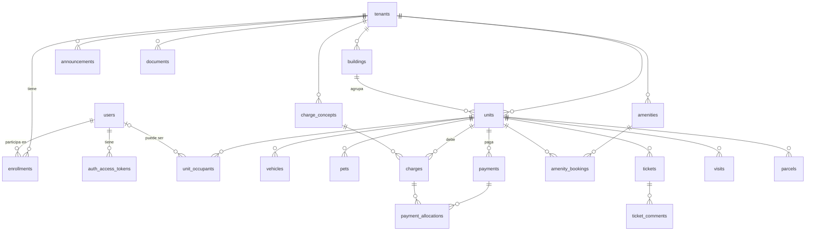

# Modelo de datos — AptoPH

> Estado: **propuesta** · Motor: PostgreSQL 18 · ORM: AdonisJS Lucid
>
> Este documento describe el modelo sugerido. Cada tabla se implementará como una
> migración (`apps/api/database/migrations`) y un modelo Lucid (`apps/api/app/models`).
> Los nombres de tablas y columnas van en **inglés** y en `snake_case`; Lucid los expone
> en `camelCase` en los modelos.

## 1. Principios

### 1.1 Multi-tenancy

- Un **tenant** es una copropiedad (conjunto residencial, edificio, centro comercial…).
- **Todas** las tablas de negocio llevan `tenant_id NOT NULL` con FK a `tenants.id`.
- Las únicas tablas **globales** (sin `tenant_id`) son: `tenants`, `users`,
  `auth_access_tokens` y las tablas de plataforma del SaaS
  (planes, suscripciones — fase posterior).
- **Aislamiento a nivel de base de datos (no sólo de aplicación):**
  - Cada tabla de tenant tiene, además de su PK, un índice único `(tenant_id, id)`.
  - Las FKs entre tablas de tenant son **compuestas**: `(tenant_id, unit_id) → units(tenant_id, id)`.
    Así PostgreSQL rechaza cualquier registro que apunte a una fila de **otro** tenant,
    aunque la aplicación tenga un bug.
  - Todos los índices de consulta empiezan por `tenant_id`.
- **Aislamiento a nivel de aplicación (AdonisJS):**
  - Middleware `tenant` (implementado) que resuelve el tenant activo con el header `X-Tenant-Id`,
    verifica que el usuario autenticado tenga un `enrollment` activo en él y lo deja en
    `ctx.tenant` / `ctx.enrollment`.
  - Un `BaseTenantModel` (mixin) que agrega el scope `forTenant(tenantId)` y asigna
    `tenant_id` automáticamente en `beforeCreate`. Las consultas **nunca** se hacen sin ese scope.
  - Las policies (Bouncer) deciden por `enrollment.role`, nunca por el usuario global.
- **Defensa adicional (opcional, fase posterior):** Row Level Security de PostgreSQL con
  `SET app.tenant_id = …` por transacción.

### 1.2 Identificadores

- PK `id uuid` con default `uuidv7()` (función nativa de PostgreSQL 18): son ordenables
  por tiempo y no exponen cuántos registros tiene cada tenant (los IDs secuenciales sí lo harían).
- `tenants.slug` es un identificador legible para URLs y subdominios.

> `auth_access_tokens.id` sigue siendo `increments`: lo gestiona `@adonisjs/auth` y no se expone
> (el token público es opaco). Su `tokenable_id` sí es `uuid`.

### 1.3 Convenciones

| Convención | Regla |
| --- | --- |
| Timestamps | `created_at`, `updated_at` (`timestamptz`) en todas las tablas |
| Borrado lógico | `deleted_at timestamptz NULL` en entidades que se archivan (units, users, documents…) |
| Dinero | `numeric(14,2)` + `currency` en el tenant (COP por defecto). Nunca `float` |
| Enums | Columnas `varchar` con `CHECK` (más fácil de migrar que tipos `ENUM` de Postgres). Los valores viven en `packages/shared` |
| Fechas sin hora | `date` (p. ej. `due_on`, `starts_on`) |
| Autoría | `created_by_id → users.id` cuando importa saber quién creó el registro |
| Archivos | Se guarda la ruta/clave del storage (`file_key`), no el binario |

## 2. Diagrama (núcleo)



## 3. Tablas globales

### `tenants` — copropiedades

| Columna | Tipo | Notas |
| --- | --- | --- |
| id | uuid PK | |
| name | varchar(150) | Nombre comercial: "Conjunto Reservas del Bosque" |
| slug | varchar(80) UNIQUE | Para subdominio/URL |
| legal_name | varchar(200) NULL | Razón social de la persona jurídica |
| tax_id | varchar(30) NULL | NIT |
| property_type | varchar(30) | `residential`, `commercial`, `mixed` |
| address | varchar(255) NULL | |
| city | varchar(100) NULL | |
| country_code | char(2) | `CO` por defecto |
| timezone | varchar(50) | `America/Bogota` |
| currency | char(3) | `COP` |
| logo_file_key | varchar NULL | |
| status | varchar(20) | `trial`, `active`, `suspended`, `cancelled` |
| settings | jsonb | Configuración flexible (intereses de mora, día de corte, etc.) |
| created_at / updated_at / deleted_at | timestamptz | |

### `subscriptions` — plan del conjunto (uno por tenant)

Se crea con el registro autoservicio (`/registro`). Los tenants **sin** suscripción son cuentas
administradas (demo, pilotos) y no tienen restricciones. Planes y precios en
`packages/shared/src/billing.ts`.

| Columna | Tipo | Notas |
| --- | --- | --- |
| id | uuid PK | |
| tenant_id | uuid UNIQUE FK → tenants | `ON DELETE CASCADE` |
| plan | varchar(20) | `completo`, `empresarial` |
| billing_cycle | varchar(10) | `monthly`, `annual` |
| status | varchar(20) | `trialing`, `active`, `past_due`, `cancelled` |
| declared_units | int | Unidades declaradas en el registro (cotización antes de cargar el censo) |
| trial_ends_at | timestamptz NULL | Fin de la prueba (30 días) |
| current_period_ends_at | timestamptz NULL | Fin del periodo pagado |
| activation_requested_at | timestamptz NULL | Última solicitud de activación desde el backoffice |
| cancelled_at | timestamptz NULL | |
| created_at / updated_at | timestamptz | |

Con la prueba vencida o el periodo pagado expirado, el backoffice queda en **solo lectura**: las
rutas de escritura responden `402` con `rule: subscription_inactive`. La app de residentes sigue
funcionando.

### `users` — personas con cuenta en la plataforma

Un usuario es **global**: la misma persona puede vivir en un conjunto y trabajar o ser
consejera en otro, con una sola cuenta.

| Columna | Tipo | Notas |
| --- | --- | --- |
| id | uuid PK | |
| full_name | varchar(150) | |
| email | varchar(254) UNIQUE | Login |
| password | varchar | Hash (argon2/scrypt) |
| phone | varchar(30) NULL | |
| document_type | varchar(10) NULL | `CC`, `CE`, `NIT`, `PP`, `TI` |
| document_number | varchar(30) NULL | Único junto con `document_type` |
| avatar_file_key | varchar NULL | |
| is_platform_admin | boolean | Superadmin del SaaS (no de un conjunto) |
| email_verified_at | timestamptz NULL | |
| last_login_at | timestamptz NULL | |
| status | varchar(20) | `active`, `blocked` |
| created_at / updated_at / deleted_at | timestamptz | |

### `auth_access_tokens`

La gestiona `@adonisjs/auth`: un access token por sesión iniciada (ver
[authentication.md](authentication.md)). `tokenable_id` es `uuid` y `name` guarda la app que lo pidió
(`Backoffice`, `Portal de residentes`…).

## 4. Pertenencia y roles

### `enrollments` — usuario ↔ tenant ↔ rol (tabla pivote)

Define **qué puede hacer un usuario dentro de un tenant**. Una persona puede tener
varios roles en el mismo conjunto (p. ej. `owner` y `council_member`): se crea un
enrollment por rol.

| Columna | Tipo | Notas |
| --- | --- | --- |
| id | uuid PK | |
| tenant_id | uuid FK → tenants | |
| user_id | uuid FK → users | |
| role | varchar(30) | Ver tabla de roles |
| status | varchar(20) | `invited`, `active`, `suspended`, `revoked` |
| title | varchar(100) NULL | Cargo visible: "Presidente del consejo", "Portero turno noche" |
| starts_on | date NULL | Inicio del periodo (útil para consejo y administración) |
| ends_on | date NULL | |
| invited_by_id | uuid NULL FK → users | |
| invitation_token_hash | varchar NULL | Para aceptar la invitación por correo |
| accepted_at | timestamptz NULL | |
| created_at / updated_at | timestamptz | |

Índices / restricciones:
- `UNIQUE (tenant_id, user_id, role)`
- `INDEX (user_id, status)`: para listar "mis conjuntos" al iniciar sesión.

**Roles** (`role`):

| Valor | Español | App |
| --- | --- | --- |
| `administrator` | Administrador(a) | backoffice |
| `council_member` | Miembro del consejo de administración | backoffice |
| `accountant` | Contador(a) | backoffice |
| `fiscal_reviewer` | Revisor(a) fiscal | backoffice |
| `staff` | Trabajador (mantenimiento, aseo, jardinería) | backoffice / móvil |
| `security_guard` | Vigilante / portería | backoffice / móvil |
| `resident` | Residente (propietario, arrendatario o familiar) | web / móvil |

> El enrollment dice **qué rol** tiene alguien en el conjunto. Su relación con una
> unidad concreta (propietario o arrendatario del apto 302) va en `unit_occupants`.
> Se usa `renter` (no `tenant`) para "arrendatario", para no confundirlo con el tenant
> del multi-tenancy.

## 5. Estructura física

### `buildings` — torres / bloques / etapas

| Columna | Tipo | Notas |
| --- | --- | --- |
| id | uuid PK | |
| tenant_id | uuid FK | |
| name | varchar(80) | "Torre 1", "Bloque B" |
| floors | smallint NULL | |
| sort_order | smallint | |
| created_at / updated_at | timestamptz | |

`UNIQUE (tenant_id, name)`

### `units` — unidades privadas (apartamento, casa, local, parqueadero, depósito)

| Columna | Tipo | Notas |
| --- | --- | --- |
| id | uuid PK | |
| tenant_id | uuid FK | |
| building_id | uuid NULL FK compuesta → buildings | |
| code | varchar(30) | "302", "T1-302", "P-15" |
| type | varchar(20) | `apartment`, `house`, `commercial`, `parking`, `storage` |
| floor | smallint NULL | |
| private_area | numeric(10,2) NULL | Área privada en m² |
| ownership_coefficient | numeric(9,6) | Coeficiente de copropiedad (base para cuotas y votaciones) |
| parent_unit_id | uuid NULL FK compuesta → units | Parqueadero/depósito anexo a un apartamento |
| status | varchar(20) | `occupied`, `vacant`, `under_construction` |
| notes | text NULL | |
| created_at / updated_at / deleted_at | timestamptz | |

`UNIQUE (tenant_id, building_id, code)`

### `unit_occupants` — personas vinculadas a una unidad

| Columna | Tipo | Notas |
| --- | --- | --- |
| id | uuid PK | |
| tenant_id | uuid FK | |
| unit_id | uuid FK compuesta → units | |
| user_id | uuid NULL FK → users | NULL si la persona no tiene cuenta (p. ej. un menor) |
| full_name | varchar(150) | Se guarda siempre, tenga o no cuenta |
| document_type / document_number | varchar NULL | |
| phone / email | varchar NULL | |
| relationship | varchar(20) | `owner`, `renter`, `family_member`, `domestic_worker`, `other` |
| is_primary_contact | boolean | Responsable de la unidad para notificaciones/cobros |
| is_billing_responsible | boolean | A quién se emite la cuenta de cobro |
| starts_on / ends_on | date NULL | Vigencia (p. ej. contrato de arriendo) |
| created_at / updated_at | timestamptz | |

`INDEX (tenant_id, unit_id)`, `INDEX (tenant_id, user_id)`

### `vehicles`

| Columna | Tipo | Notas |
| --- | --- | --- |
| id, tenant_id | | |
| unit_id | uuid FK compuesta → units | |
| plate | varchar(10) | `UNIQUE (tenant_id, plate)` |
| type | varchar(20) | `car`, `motorcycle`, `bicycle`, `other` |
| brand / model / color | varchar NULL | |
| parking_unit_id | uuid NULL FK compuesta → units | Parqueadero asignado |
| created_at / updated_at / deleted_at | | |

### `pets`

| Columna | Tipo | Notas |
| --- | --- | --- |
| id, tenant_id | | |
| unit_id | uuid FK compuesta → units | |
| name | varchar(60) | |
| species | varchar(20) | `dog`, `cat`, `other` |
| breed | varchar(60) NULL | |
| is_potentially_dangerous | boolean | Requisito legal para algunas razas |
| vaccination_file_key | varchar NULL | |
| created_at / updated_at / deleted_at | | |

## 6. Finanzas y contabilidad

El módulo completo (reglas de cálculo, asientos y permisos) está en [`docs/finance.md`](finance.md).
Aquí solo el mapa de tablas; todas llevan `tenant_id` y FK compuestas como el resto del modelo.
Los valores son `numeric` y se exponen como `string`; en el código se calcula en centavos enteros.

### Cartera

| Tabla | Para qué |
| --- | --- |
| `charge_concepts` | Conceptos de cobro (`ordinary_fee`, `extraordinary_fee`, `interest`, `fine`, `parking`, `visitor_parking`, `amenity_booking`, `service`, `opening_balance`, `other`), con su cuenta por cobrar, su cuenta de ingreso, si genera mora y si tiene pronto pago. `code` identifica los conceptos del sistema. |
| `contribution_modules` / `contribution_module_units` | Módulos de contribución (torre, locales, parqueaderos) con la participación (`share`) de cada unidad. |
| `fee_schedules` | Historial de cálculos de cuotas: método (`coefficient`, `module`, `area`, `equal`, `fixed_by_type`), total mensual, presupuesto base y parámetros. |
| `recurring_charges` | Tarifa vigente de cada unidad por concepto, con `starts_on` / `ends_on` (meses). Lo que se factura cada mes. |
| `billing_periods` | Un registro por mes facturado: vencimiento, pronto pago, tasa de mora aplicada, estado `open` / `closed`, totales. |
| `charges` | Cargos por unidad. Además de lo básico: `billing_period_id`, `recurring_charge_id`, `source_type` / `source_id` (de dónde viene: facturación, mora, manual, parqueadero, reserva…), `idempotency_key` único (`rec:…`, `int:…`, `booking:…`), descuento por pronto pago y anulación (`cancelled_at`, `cancellation_reason`). |
| `charge_adjustments` | Notas crédito, descuentos por pronto pago y anulaciones de un cargo. |
| `payments` | Recibos de caja: `number` consecutivo, `cash_account_id`, `unapplied_amount` (saldo a favor), estado `pending_review` / `confirmed` / `rejected` / `reversed` con sus motivos. |
| `payment_allocations` | Aplicación de un pago a cargos (un pago cubre varios cargos y un cargo admite varios abonos). |

### Gastos, bancos y presupuesto

| Tabla | Para qué |
| --- | --- |
| `vendors` | Proveedores: documento, contacto, cuenta bancaria y cuenta de gasto habitual. |
| `bills` / `bill_lines` | Facturas de proveedores: líneas por cuenta de gasto, IVA, retenciones (fuente, IVA, ICA), neto y saldo. |
| `vendor_payments` / `vendor_payment_allocations` | Comprobantes de egreso numerados y las facturas que pagan. |
| `cash_accounts` | Cuentas bancarias y cajas, cada una con su auxiliar contable (`ledger_account_id`). |
| `budgets` / `budget_items` | Presupuesto anual por cuenta, porcentaje del fondo de imprevistos y aprobación en asamblea. |

### Contabilidad

| Tabla | Para qué |
| --- | --- |
| `ledger_accounts` | Plan de cuentas (PUC simplificado) por conjunto: código, clase, naturaleza, `is_postable`, `system_key` para las cuentas que usa el sistema. |
| `journal_entries` / `journal_lines` | Comprobantes por partida doble, numerados. Cada línea lleva débito o crédito y el tercero (`unit_id` o `vendor_id`). Nunca se editan: se reversan (`reverses_entry_id`). |
| `document_sequences` | Consecutivos por tipo de documento (recibos, egresos, comprobantes). |

## 7. Zonas comunes

### `amenities` — zonas comunes reservables

| Columna | Tipo | Notas |
| --- | --- | --- |
| id, tenant_id | | |
| name | varchar(100) | "Salón social", "BBQ", "Cancha" |
| description | text NULL | |
| capacity | smallint NULL | |
| booking_fee | numeric(14,2) NULL | |
| requires_approval | boolean | |
| rules | jsonb | Horarios, duración máx., anticipación, límite por unidad |
| is_active | boolean | |
| created_at / updated_at | | |

### `amenity_bookings`

| Columna | Tipo | Notas |
| --- | --- | --- |
| id, tenant_id | | |
| amenity_id | uuid FK compuesta → amenities | |
| unit_id | uuid FK compuesta → units | |
| requested_by_id | uuid FK → users | |
| starts_at / ends_at | timestamptz | |
| guests_count | smallint NULL | |
| status | varchar(20) | `pending`, `approved`, `rejected`, `cancelled` |
| charge_id | uuid NULL FK compuesta → charges | Si la reserva genera un cobro |
| reviewed_by_id | uuid NULL FK → users | |
| created_at / updated_at | | |

Restricción recomendada: `EXCLUDE USING gist (amenity_id WITH =, tstzrange(starts_at, ends_at) WITH &&) WHERE status IN ('pending','approved')`
para impedir reservas solapadas (requiere la extensión `btree_gist`).

## 8. Comunicación y solicitudes

### `announcements` — comunicados / circulares

| Columna | Tipo | Notas |
| --- | --- | --- |
| id, tenant_id | | |
| title | varchar(200) | |
| body | text | Markdown |
| audience | varchar(20) | `all`, `residents`, `owners`, `council`, `staff` |
| published_at | timestamptz NULL | NULL = borrador |
| is_pinned | boolean | |
| created_by_id | uuid FK → users | |
| created_at / updated_at / deleted_at | | |

### `announcement_reads` — confirmación de lectura

`id, tenant_id, announcement_id (FK compuesta), user_id, read_at` · `UNIQUE (announcement_id, user_id)`

### `tickets` — PQRS y solicitudes de mantenimiento

| Columna | Tipo | Notas |
| --- | --- | --- |
| id, tenant_id | | |
| number | integer | Consecutivo por tenant: `UNIQUE (tenant_id, number)` |
| unit_id | uuid NULL FK compuesta → units | |
| created_by_id | uuid FK → users | |
| assigned_to_id | uuid NULL FK → users | |
| type | varchar(20) | `petition`, `complaint`, `claim`, `suggestion`, `maintenance` |
| subject | varchar(200) | |
| description | text | |
| priority | varchar(10) | `low`, `medium`, `high`, `urgent` |
| status | varchar(20) | `open`, `in_progress`, `resolved`, `closed` |
| resolved_at | timestamptz NULL | |
| created_at / updated_at | | |

### `ticket_comments`

`id, tenant_id, ticket_id (FK compuesta), author_id, body, is_internal (visible sólo para backoffice), created_at, updated_at`

## 9. Portería y seguridad

### `visits` — visitantes

| Columna | Tipo | Notas |
| --- | --- | --- |
| id, tenant_id | | |
| unit_id | uuid FK compuesta → units | |
| visitor_name | varchar(150) | |
| visitor_document | varchar(30) NULL | |
| vehicle_plate | varchar(10) NULL | |
| type | varchar(20) | `guest`, `delivery`, `service_provider`, `other` |
| authorized_by_id | uuid NULL FK → users | Residente que pre-autoriza |
| access_code | varchar(12) NULL | Código/QR de acceso |
| expected_at | timestamptz NULL | |
| checked_in_at / checked_out_at | timestamptz NULL | |
| registered_by_id | uuid NULL FK → users | Vigilante |
| created_at / updated_at | | |

### `parcels` — correspondencia y paquetes

| Columna | Tipo | Notas |
| --- | --- | --- |
| id, tenant_id | | |
| unit_id | uuid FK compuesta → units | |
| carrier | varchar(60) NULL | |
| description | varchar(255) NULL | |
| photo_file_key | varchar NULL | |
| received_at | timestamptz | |
| received_by_id | uuid FK → users | Vigilante |
| delivered_at | timestamptz NULL | |
| delivered_to_name | varchar(150) NULL | |
| status | varchar(20) | `pending`, `delivered`, `returned` |
| created_at / updated_at | | |

## 10. Documentos

### `documents` — reglamento, actas, estados financieros

| Columna | Tipo | Notas |
| --- | --- | --- |
| id, tenant_id | | |
| title | varchar(200) | |
| category | varchar(30) | `bylaws`, `minutes`, `financial_statement`, `contract`, `policy`, `other` |
| file_key | varchar | |
| mime_type | varchar(100) | |
| size_bytes | bigint | |
| visibility | varchar(20) | `public` (todos los residentes), `council`, `administration` |
| uploaded_by_id | uuid FK → users | |
| created_at / updated_at / deleted_at | | |

## 11. Auditoría

### `audit_logs`

| Columna | Tipo | Notas |
| --- | --- | --- |
| id | uuid PK | |
| tenant_id | uuid NULL FK | NULL para acciones de plataforma |
| user_id | uuid NULL FK → users | |
| action | varchar(50) | `created`, `updated`, `deleted`, `login`, … |
| auditable_type | varchar(50) | Nombre de la tabla/modelo |
| auditable_id | uuid | |
| changes | jsonb NULL | `{ before, after }` |
| ip_address | inet NULL | |
| created_at | timestamptz | |

`INDEX (tenant_id, auditable_type, auditable_id)`

## 12. Fases posteriores (no incluidas aún)

- **Asambleas**: `assemblies`, `assembly_attendees` (con poderes/representación), `assembly_votes`, votación ponderada por `ownership_coefficient` y cálculo de quórum.
- **Contabilidad**: presupuesto anual, gastos y proveedores (`budgets`, `expenses`, `vendors`).
- **SaaS**: `plans`, `subscriptions`, `invoices` de la plataforma hacia cada tenant.
- **Notificaciones**: `notifications` y `device_tokens` (push para la app Flutter).

## 13. Implementación

Todas las tablas de este documento ya tienen migración (`apps/api/database/migrations`) y modelo
Lucid (`apps/api/app/models`). Notas:

- `database/tenant_schema.ts` define los helpers comunes: `tenantTable` (id uuidv7, `tenant_id`,
  `UNIQUE (tenant_id, id)`) y `tenantForeign` (FK compuesta).
- Los valores permitidos de las columnas tipo enum viven en `packages/shared/src/domain.ts` y se
  usan tanto en los `CHECK` de las migraciones como en validadores y frontends.
- Las consultas de datos de un tenant se hacen **siempre** a través de las relaciones del modelo
  `Tenant`: `ctx.tenant.related('units').query()` / `.create()`.
- Las columnas `numeric` se exponen como `string` en la API para no perder precisión.

### Orden de migraciones

1. ✅ `users` y `auth_access_tokens` (uuid)
2. ✅ `tenants`
3. ✅ `enrollments`
3b. ✅ `oauth_*` (creadas y luego eliminadas al pasar a access tokens)
4. ✅ `buildings` → `units` → `unit_occupants` → `vehicles` → `pets`
5. ✅ `charge_concepts` → `charges` → `payments` → `payment_allocations`
6. ✅ `amenities` → `amenity_bookings`
7. ✅ `announcements` → `announcement_reads` → `tickets` → `ticket_comments`
8. ✅ `visits` → `parcels` → `documents` → `audit_logs`
9. ✅ Finanzas: plan de cuentas y comprobantes → cartera extendida (periodos, tarifas, módulos,
   presupuesto, ajustes) → proveedores, facturas, egresos y bancos

Ejemplo de FK compuesta en una migración de Lucid:

```ts
this.schema.createTable('unit_occupants', (table) => {
  table.uuid('id').primary().defaultTo(this.raw('uuidv7()'))
  table.uuid('tenant_id').notNullable().references('id').inTable('tenants').onDelete('RESTRICT')
  table.uuid('unit_id').notNullable()
  // …
  table
    .foreign(['tenant_id', 'unit_id'])
    .references(['tenant_id', 'id'])
    .inTable('units')
    .onDelete('CASCADE')
  table.index(['tenant_id', 'unit_id'])
})

// y en `units`:
table.unique(['tenant_id', 'id'])
```
