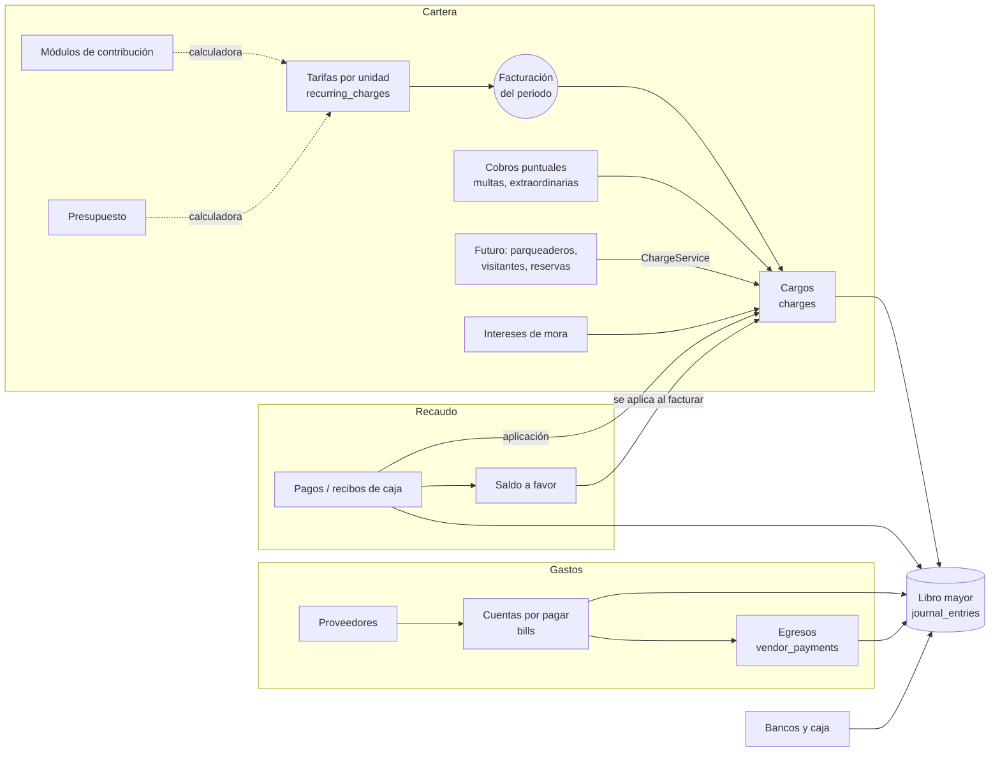

# Módulo financiero y contable

Cubre la facturación de cuotas a las unidades (cartera), el recaudo, los gastos y pagos a
proveedores, bancos y caja, el presupuesto y la contabilidad por partida doble de la copropiedad.
Está pensado para conjuntos residenciales, comerciales y mixtos en Colombia (Ley 675 de 2001).

> Todo lo que mueve dinero genera un **comprobante contable** en el mismo `COMMIT`. Los reportes
> (estado de cuenta, balance, estado de resultados, auxiliares) salen del libro mayor, así que
> nunca se descuadran con la cartera ni con los bancos.

## 1. Mapa del módulo

## 2. Cómo se calcula la cuota de administración

La cuota de cada unidad vive en **tarifas** (`recurring_charges`: unidad, concepto, valor, vigente
desde/hasta). La facturación mensual solo copia las tarifas vigentes del mes. Así cualquier tipo de
copropiedad se resuelve: lo que cambia es cómo se llenan las tarifas, y siempre se pueden ajustar a
mano unidad por unidad.

La **calculadora de cuotas** (`fee_schedules`) llena las tarifas de un concepto a partir de una
fecha. Métodos:

| Método | Uso típico | Cálculo |
| --- | --- | --- |
| `coefficient` | Residencial (lo normal por ley) | Total mensual × coeficiente de la unidad ÷ suma de coeficientes incluidos |
| `module` | Mixto o comercial con **módulos de contribución** (art. 29 Ley 675) | Para cada módulo: su total mensual × participación de la unidad en el módulo ÷ suma del módulo. La cuota es la suma de los módulos en que participa |
| `area` | Reglamentos que cobran por m² | Total mensual × área privada ÷ suma de áreas |
| `equal` | Conjuntos de casas iguales | Total mensual ÷ número de unidades |
| `fixed_by_type` | Tarifa por tipo (apartamento, local, parqueadero…) | Valor fijo según el tipo de unidad |

Opciones comunes:

- **Base mensual**: un valor escrito o tomado del **presupuesto aprobado**:
  `(gastos × (1 + % fondo de imprevistos) − otros ingresos presupuestados) ÷ 12`.
- **Tipos de unidad incluidos** (p. ej. excluir depósitos).
- **Anexos en la unidad principal**: los parqueaderos/depósitos con `parent_unit_id` suman su parte
  a la cuota del apartamento, porque el residente no ve unidades que no ocupa.
- **Redondeo** al múltiplo de 1, 10, 50, 100 o 1.000 pesos, al más cercano o hacia arriba.
- **Vigente desde** un mes: cierra las tarifas anteriores del concepto el mes anterior y crea las
  nuevas. Primero se muestra una **vista previa**.

## 3. Facturación del periodo

`billing_periods` tiene una fila por mes (`period` = primer día). Generar es **idempotente**: cada
cargo lleva una `idempotency_key` única (`rec:{tarifa}:{mes}`, `int:{cargo}:{mes}`,
`booking:{reserva}`…), así que repetirla solo agrega lo que falte. Corre en una transacción con un
bloqueo por conjunto (`pg_advisory_xact_lock`).

Pasos:

1. Cargos de las tarifas vigentes del mes (valor 0: no se cobra).
2. **Intereses de mora** (si están activos): sobre el saldo de capital de los cargos vencidos antes
   del primer día del mes, cuyo concepto `accrues_interest`. Tasa mensual simple configurada por el
   conjunto; nunca sobre intereses (no hay anatocismo).
3. **Descuento por pronto pago** (opcional): a los cargos de conceptos con
   `allows_early_discount` se les fija `discount_until` y `discount_amount`.
4. Comprobante contable de causación: débito a cuentas por cobrar por unidad, crédito a ingresos.
5. **Fondo de imprevistos**: si el presupuesto aprobado del año tiene % de fondo, se causa la
   apropiación del mes (gasto contra el fondo patrimonial).
6. Se aplica el **saldo a favor** de las unidades a los cargos nuevos.

Fechas: vence el día `dueDay` del mes (por defecto 10); el pronto pago, hasta `earlyDiscount.day`.
Un periodo **cerrado** no admite más generación.

### Tasa de mora

El art. 30 de la Ley 675 fija la mora en 1,5 veces el interés bancario corriente, sin superar la
tasa de usura que certifica la Superintendencia Financiera cada mes. La asamblea puede fijar una
menor. AptoPH guarda la tasa **mensual** que decida el conjunto, toma una copia en cada periodo y
la valida contra un tope de 5 % mensual. El administrador debe actualizarla cuando cambia la
certificación.

## 4. Cargos y ajustes

`charges` es la cuenta por cobrar por unidad. Origen (`source_type`): `recurring`, `interest`,
`manual`, y para módulos futuros `parking`, `visitor_parking`, `amenity_booking`. Todos se crean con
`ChargeService.create`, que valida el concepto, causa el ingreso y aplica el saldo a favor.

Los cargos emitidos no se editan:

- **Anular** (solo sin abonos): estado `cancelled` con motivo; reversa la causación.
- **Nota crédito**: rebaja parcial con motivo (`charge_adjustments`).
- **Descuento por pronto pago**: ajuste automático al aplicar un pago a tiempo.

## 5. Recaudo

- La administración **registra** un pago (unidad, valor, fecha, medio, referencia, cuenta bancaria
  o caja) y obtiene un **recibo de caja** con consecutivo.
- El residente **reporta** un pago desde el portal; queda `pending_review` hasta que la
  administración lo confirma (eligiendo la cuenta donde entró) o lo rechaza con motivo.
- **Aplicación** automática: primero intereses (art. 1653 del Código Civil), luego lo más antiguo
  por fecha de vencimiento. Se puede indicar a mano qué cargos paga.
- Si sobra dinero queda como **saldo a favor** (anticipo) y se aplica solo al facturar.
- Un pago confirmado no se edita: se **reversa** con motivo y se registra de nuevo.

### Recibo de caja y paz y salvo en PDF

- **Recibo de caja** (`GET /finance/payments/:id/receipt`; el residente,
  `GET /resident/payments/:id/receipt`): para pagos confirmados o reversados, que tienen número.
  Muestra el conjunto, la unidad, a nombre de quién (responsable de pago, si no el propietario o
  el contacto principal), el valor en números y en letras, a qué cobros se aplicó y el saldo a
  favor. Si se reversó, lleva el sello **ANULADO** y el motivo.
- **Paz y salvo** (`POST /finance/units/:unitId/clearances`; el residente que es propietario,
  arrendatario o contacto principal, `POST /resident/units/:unitId/clearances`): solo si la unidad
  no tiene saldo **vencido**. Tiene consecutivo propio, vale hasta fin de mes o hasta el día antes
  del próximo vencimiento, e indica los cobros ya facturados que aún no vencen y no cubre.
- Cada paz y salvo tiene un **código de verificación** (`ABCD-2345-XY`) y el enlace
  `<RESIDENTS_URL>/verificar/<código>`: quien lo recibe (notaría, comprador, inmobiliaria)
  confirma sin sesión que es auténtico y si sigue vigente (`GET /public/clearances/:code`).
- Los PDF se generan en el servidor con pdfkit y las fuentes de la marca (`resources/fonts`, OFL).

## 6. Gastos y proveedores

- **Proveedores** (terceros): NIT/CC, contacto, cuenta bancaria y cuenta de gasto por defecto.
- **Cuentas por pagar** (`bills`): factura o cuenta de cobro del proveedor, con líneas por cuenta de
  gasto, IVA y retenciones (fuente, IVA, ICA). La copropiedad no es responsable de IVA, así que el
  IVA pagado se lleva como mayor valor del gasto. Neto a pagar = subtotal + IVA − retenciones.
- **Egresos** (`vendor_payments`): comprobante de egreso con consecutivo, desde una cuenta bancaria
  o caja, aplicado a una o varias facturas. Se reversan, no se editan.
- Un **gasto de contado** se registra como cuenta por pagar y su egreso en el mismo paso.

## 7. Bancos y caja

`cash_accounts`: cuentas de ahorros/corriente y cajas. Cada una crea su subcuenta contable
(`1110xxxx` bancos, `1105xxxx` caja) y puede tener saldo inicial. Sus movimientos son el auxiliar
de esa subcuenta. Los traslados entre cuentas generan su comprobante.

### Conciliación bancaria

En **Finanzas → Bancos → Conciliación bancaria** se importa el extracto que se descarga de la
sucursal virtual del banco y se cruza cada movimiento con lo que ya está en AptoPH.

1. **Importar** un CSV o Excel (.xlsx; los .xls antiguos se guardan antes como .xlsx). Cada
   banco exporta su formato: el sistema encuentra la fila de encabezados (aunque antes vengan los
   datos de la cuenta) y adivina las columnas de fecha, descripción, referencia y valor (una
   columna con signo, o créditos y débitos). Se pueden corregir viendo cómo queda la lectura.
   Las filas sin fecha (saldos, totales) se omiten. Un movimiento que ya se importó en otro
   extracto de la misma cuenta no se repite.
2. **Sugerencias** para cada movimiento pendiente:
   - Entrada con el mismo valor que un **recibo de caja** de esa cuenta (fecha a ±5 días): se
     vincula.
   - Entrada con el mismo valor que un **pago reportado** por un residente (±10 días): se
     confirma con esa cuenta y se aplica.
   - Entrada cuya **referencia** es el código de una unidad (`101`, `T2-101`, `2101`…): se
     registra el pago de esa unidad con la fecha del extracto.
   - Salida con el mismo valor que un **comprobante de egreso** de esa cuenta: se vincula.

   Son **seguras** cuando coinciden por referencia, y por revisar cuando solo coinciden por valor y
   fecha o la unidad sale de la descripción. "Aplicar sugerencias seguras" las aplica todas, cada
   una en su transacción.
3. A mano: registrar el pago de cualquier unidad, elegir otro recibo o pago reportado, otro egreso
   o **ignorar** con una nota (comisiones, 4×1000, intereses, traslados).
4. **Deshacer** devuelve el movimiento a pendiente; el recibo que se creó o confirmó sigue como
   está (si sobra, se reversa desde Recaudo). Un extracto se puede eliminar mientras no tenga
   movimientos conciliados.

Cada recibo o egreso se concilia con un movimiento como máximo (índice único). Registrar o
confirmar un pago desde aquí genera su comprobante contable y notifica al residente como siempre.

## 8. Presupuesto

`budgets` por año (borrador → aprobado en asamblea, con acta), con rubros (`budget_items`) sobre
cuentas de ingreso o gasto y el **% del fondo de imprevistos** (mínimo legal 1 %). La ejecución
compara lo causado en el libro mayor contra lo presupuestado a la fecha.

## 9. Contabilidad

- **Plan de cuentas** por conjunto, sembrado con un PUC simplificado para propiedad horizontal
  (`app/services/finance/chart_template.ts`). Se pueden agregar subcuentas y renombrar o desactivar
  cuentas. Las cuentas que usa el sistema se reconocen por `system_key`.
- **Comprobantes** (`journal_entries` + `journal_lines`): numerados, cuadrados (débitos = créditos),
  con tercero opcional (unidad o proveedor) por línea. Nunca se borran: se reversan.
- **Notas de contabilidad** manuales para ajustes, saldos iniciales y lo que no cubren los flujos.
- **Fecha de cierre** (`lockedUntil`): no se aceptan comprobantes con fecha igual o anterior.
- **Reportes**: balance de prueba, estado de resultados, estado de situación financiera,
  libro auxiliar por cuenta y tercero, estado de cuenta por unidad, cartera y cuentas por pagar por
  edades, y exportación a CSV para el software del contador.

### Asientos automáticos

| Hecho | Débito | Crédito |
| --- | --- | --- |
| Causación de un cargo | 1305xx por cobrar (unidad) | 4xxx ingreso del concepto |
| Pago recibido | 1110/1105 banco o caja | 1305xx por cobrar (unidad) y 280505 anticipos si sobra |
| Saldo a favor aplicado | 280505 anticipos | 1305xx por cobrar |
| Descuento pronto pago | 417505 descuentos | 1305xx por cobrar |
| Nota crédito / anulación | 4xxx ingreso del concepto | 1305xx por cobrar |
| Factura de proveedor | 5xxx gasto (+ IVA) | 220505 proveedores (neto), 2365/2367/2368 retenciones |
| Egreso | 220505 proveedores | 1110/1105 banco o caja |
| Fondo de imprevistos | 539595 apropiación | 330595 fondo de imprevistos |
| Saldo inicial de banco | 1110/1105 | 370505 excedentes acumulados |
| Saldo inicial de cartera (concepto «Saldo inicial») | 1305xx | 370505 |

## 10. Permisos

| Rol | Finanzas |
| --- | --- |
| Administración, contabilidad | Leer y operar |
| Consejo, revisoría fiscal | Solo leer |
| Personal, vigilancia | Sin acceso |
| Residente | Su estado de cuenta, sus pagos y reportar pagos |

## 11. Configuración (`tenants.settings.finance`)

| Clave | Por defecto | |
| --- | --- | --- |
| `dueDay` | 10 | Día de vencimiento de la cuota |
| `lateInterest.enabled` / `monthlyRate` | sí / 2 % | Tasa mensual simple |
| `earlyDiscount.enabled` / `rate` / `day` | no / 0 % / 5 | Descuento por pronto pago |
| `rounding` / `roundingMode` | 100 / `nearest` | Redondeo de cuotas calculadas |
| `applicationOrder` | `interest_first` | O `oldest_first` |
| `lockedUntil` | — | Cierre contable |

## 12. Pantallas

**Backoffice → Finanzas** (roles de finanzas; la configuración solo para quien opera):

| Pestaña | Qué se hace |
| --- | --- |
| Resumen | Facturado, recaudado, cartera vencida, saldos a favor, bancos, gastos, cuentas por pagar y pagos por revisar; tendencia de seis meses. |
| Facturación | Periodos (vista previa → generar, completar, cerrar, reabrir) y cobros con filtros; cobro manual a unidades o a todo un tipo; detalle con nota crédito y anulación. |
| Tarifas | Tarifas vigentes por mes, calculadora de cuotas (por coeficiente, módulos, área, iguales o fijo por tipo; desde un valor o desde el presupuesto), historial de cálculos, conceptos y módulos de contribución. |
| Recaudo | Recibos de caja (descarga en PDF), reportes de residentes por confirmar o rechazar, reversión y exportación CSV. |
| Cartera | Edades de la deuda por unidad y estado de cuenta de cada unidad (también desde el detalle de la unidad), con el paz y salvo: expedirlo y descargar los anteriores. |
| Gastos | Facturas de proveedores (con IVA, retenciones o pago inmediato de caja menor), egresos, proveedores y cuentas por pagar por edades. |
| Bancos | Cuentas y cajas con su saldo, traslados, enlace a su libro auxiliar y la conciliación bancaria (importar extractos y conciliar sus movimientos). |
| Presupuesto | Partidas por cuenta, aprobación con acta, cuota mensual resultante y ejecución con CSV. |
| Contabilidad | Libro diario con detalle y reversión, notas de contabilidad y plan de cuentas (subcuentas). |
| Informes | Estado de resultados, balance general, balance de prueba y libro auxiliar, con CSV. |
| Configuración | Vencimiento, redondeo, orden de aplicación, mora, pronto pago y cierre contable. |

**Portal de residentes → Mi unidad**: saldo, cobros abiertos, valor para quedar al día (con pronto
pago), reportar un pago con su comprobante adjunto, historial de pagos con su estado, sus
comprobantes y el recibo de caja en PDF, el paz y salvo (cuando está al día) y movimientos del
último año. La página pública `/verificar/<código>` confirma un paz y salvo sin sesión.

## 13. Pendiente (siguientes fases)

- Cobros automáticos desde parqueaderos asignados, parqueadero de visitantes y reservas (el
  `ChargeService` y los conceptos ya existen).
- PDF del estado de cuenta y de la cuenta de cobro; envío por correo.
- Pagos en línea (PSE/tarjeta).
- Conciliación: contabilizar desde el extracto las comisiones y el 4×1000 que hoy se ignoran con
  una nota.
- Nómina, activos fijos y depreciación, información exógena.
